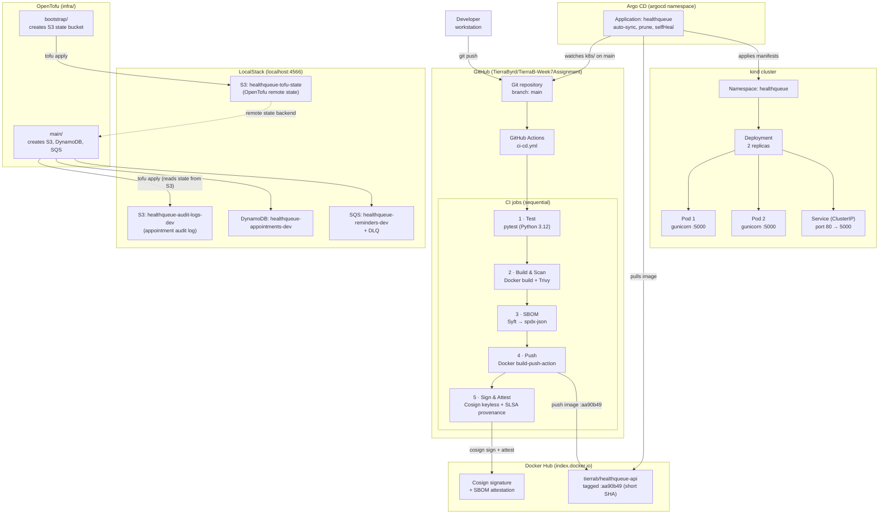

# Architecture — HealthQueue

**Author:** Maya Chen, CTO · HealthQueue

---

## System Flow Diagram

---

## Component Inventory

### Application

| Component | File(s) | What it does | Why it was chosen |
|---|---|---|---|
| **Flask API** | `app/main.py` | Exposes four REST endpoints: `GET /health`, `GET /metrics`, `GET /appointments`, `POST /appointments`, `DELETE /appointments/<id>`. In-memory appointment store; thread-safe via `threading.Lock`. | Minimal framework; no ORM required for an in-memory store; native WSGI compatibility with gunicorn. |
| **prometheus_client** | `app/main.py` | Exports `healthqueue_requests_total` (Counter), `healthqueue_request_latency_seconds` (Histogram), `healthqueue_errors_total` (Counter) on `GET /metrics`. | Zero-dependency Prometheus exposition; metrics are scraped directly by Prometheus without a sidecar. |
| **gunicorn** | `Dockerfile` | Multi-process WSGI server; 2 workers, 30-second timeout. | Production-grade process manager; handles graceful shutdown and worker reaping that Flask's dev server does not. |
| **pytest** | `tests/` | 30 test cases across all four endpoints. | Standard Python testing; `pytest-flask` test client avoids spinning up a real server for unit tests. |

### Container Image

| Component | File | What it does | Why it was chosen |
|---|---|---|---|
| **Dockerfile** | `Dockerfile` | Multi-stage-free single-stage build; base `python:3.12-slim`; creates UID 1001 `appuser`; copies only `app/` and `requirements.txt`. | `slim` minimises attack surface vs. `full`; single stage is sufficient because there is no compiled binary step. |

### CI/CD Pipeline

| Component | File | What it does | Why it was chosen |
|---|---|---|---|
| **GitHub Actions** | `.github/workflows/ci-cd.yml` | Orchestrates five jobs: test → build/scan → SBOM → push → sign. `paths-ignore` skips the pipeline for changes under `k8s/`, `argocd/`, `infra/`, `docs/`. | Native to the GitHub hosting provider; no external CI server to operate. |
| **Trivy** | CI job 2 | Scans the container image for CRITICAL/HIGH CVEs. Blocks only on fixable vulnerabilities; produces a full-report artifact. | Most widely adopted container vulnerability scanner; native GitHub Actions integration. |
| **Syft / anchore/sbom-action** | CI job 3 | Generates an SPDX JSON SBOM from the image layers. | Open-standard SPDX format; no proprietary lock-in; integrates directly with Cosign for attestation. |
| **Cosign (keyless)** | CI job 5 | Signs the image by digest; attaches the SBOM as an in-toto attestation; no long-lived private key. | Keyless signing removes the key-management burden; Sigstore ecosystem is the emerging standard for container signing. |
| **actions/attest-build-provenance** | CI job 5 | Generates SLSA Build Level 2 provenance and uploads it to the GitHub attestation store. | Meets SLSA L2 with one action; verifiable with `gh attestation verify`. |

### Image Registry

| Component | What it does | Why it was chosen |
|---|---|---|
| **Docker Hub** (`tierrab/healthqueue-api`) | Stores the container image tagged with the short commit SHA (`aa90b49`). Cosign signature and SBOM attestation are stored as OCI referrers on the same registry. | Default public registry; free for public repositories; natively supported by Argo CD and Cosign. |

### GitOps Delivery

| Component | File | What it does | Why it was chosen |
|---|---|---|---|
| **Argo CD** | `argocd/healthqueue-app.yaml` | Watches the `k8s/` path on `main`; auto-syncs, prunes removed resources, and self-heals any manual cluster drift. Applies to the `healthqueue` namespace. | Pull-based GitOps; the cluster initiates deploys rather than the CI pipeline pushing credentials into Kubernetes. Cluster state is always reconciled to Git. |

### Kubernetes Manifests

| Component | File | What it does |
|---|---|---|
| **Namespace** | `k8s/namespace.yaml` | Isolates all HealthQueue resources into the `healthqueue` namespace. |
| **Deployment** | `k8s/deployment.yaml` | Runs 2 replicas of the API; liveness/readiness probes on `/health`; `readOnlyRootFilesystem`, `runAsUser 1001`, `allowPrivilegeEscalation: false`; `emptyDir` at `/tmp` for gunicorn temp files; Prometheus scrape annotations. |
| **Service** | `k8s/service.yaml` | ClusterIP Service; port 80 → container port 5000. |

### Infrastructure as Code

| Component | Directory | What it does | Why it was chosen |
|---|---|---|---|
| **OpenTofu bootstrap** | `infra/bootstrap/` | Creates the S3 bucket `healthqueue-tofu-state` used as the remote state backend. Applied once, before `infra/main/`. | Separates the state bucket lifecycle from the application infrastructure; avoids the chicken-and-egg problem of storing state for the resource that creates the state bucket. |
| **OpenTofu main** | `infra/main/` | Creates S3 (audit logs), DynamoDB (appointments table), SQS (reminders queue + DLQ). Uses native S3 state locking (`use_lockfile = true`, OpenTofu ≥ 1.8). | OpenTofu is the open-source fork of Terraform with identical HCL syntax; chosen for license freedom (MPL 2.0) over HashiCorp BSL. |
| **LocalStack** | `localhost:4566` | Emulates AWS S3, DynamoDB, and SQS locally. OpenTofu provider targets `http://localhost:4566` instead of the real AWS API. | Zero-cost local development and CI simulation without AWS credentials or cloud spend; identical provider configuration to production. |

---

## Sources

- Argo CD documentation — <https://argo-cd.readthedocs.io/en/stable/>
- OpenTofu documentation — <https://opentofu.org/docs/>
- LocalStack documentation — <https://docs.localstack.cloud/overview/>
- Kubernetes Deployments — <https://kubernetes.io/docs/concepts/workloads/controllers/deployment/>
- The Twelve-Factor App — <https://12factor.net/>
- Sigstore / Cosign — <https://docs.sigstore.dev/>
